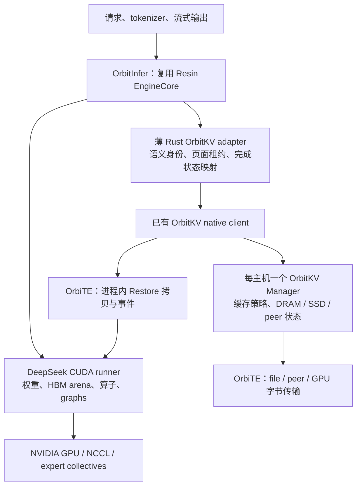

# OrbitInfer：源码审计、架构与实施计划

核查日期：2026-11-14。2026-11-15 已按此架构导入首批源码，详见[移植记录](source-import.md)。GPU 验证和 OrbitKV 接入尚未完成。

**从 Resin 的 Rust 调度与资源核心、现有 DeepSeek CUDA runner 起步，以 DeepInfer 为模型执行参考和对照基线。** OrbitInfer 补充 NVIDIA 产品配置、DeepSeek 验收和 OrbitKV 适配。第一版保留 PyTorch/CUDA 算子。

首个硬件目标已确定为 **SM100 / Blackwell**。首个模型固定为源码实际支持的 `deepseek-ai/DeepSeek-V4.1-Flash-1017`，权重 revision `1bae0e1088993b9b82de08f59de5be5a34e42170`。先做文本生成；多模态、其他 DeepSeek checkpoint、Qwen、Kimi、GLM 分别验收，不能凭品牌名宣称兼容。

## 1. 核查范围与版本

| 项目 | 本次固定 revision | 主要用途 |
| --- | --- | --- |
| [DeepInfer][d-repo] | `a679bb86ce36e883a98a97733492b686e5b9a08e` | 官方模型执行、CUDA 算子、并行与数值基线 |
| [Resin][r-repo] | `a1989594d81921be3bffe43804eb0550b216ca64` | Rust 请求生命周期、调度、页面租约和 CUDA runner |
| [OrbitKV][k-arch] | `01d9e36c6eed2910368e86cff3cd0f6b3df75ed1` | 外部缓存身份、DRAM/SSD/peer 层、查询与恢复协议 |
| [OrbiTE][t-copy] | `fbf21da8bfd7f2aec1614bc71126f09297f0cffa` | 注册内存、字节传输、CUDA 事件和物理退休 |

这是源码审计，不是性能实测。DeepInfer 从本机只读 checkout 核查；其余按上表 GitHub revision 读取。本机 OrbitKV/OrbiTE 副本落后于远端，本设计使用远端版本，未改动两个项目。

## 2. 源码结论

### DeepInfer 提供什么

公开版包含 C++ 调度器、本地 GPU KV 管理、Python 执行层，以及 FlashMLA、DeepGEMM、DeepEP、DeepSelect、TileKernels/TileLang 算子。NVIDIA 路径要求 SM100、CUDA 13；上游还有 Ascend 路径，OrbitInfer 不构建它。[D1][d-repo]

一次执行的关键链路是：`LLMEngine.step` → C++ `scheduler.schedule` → 状态复制/清零 → `worker.execute_model_async_step` → 当前 forward 与前一步采样结果回收。`DeferredRelease` 和 `pre_sampler_sync` 控制序列、状态池及复制事件的释放；`zos.hpp` 准备重叠执行元数据。Rust 并不会自动比这些 C++ 调度代码快。[D2][d-engine] [D3][d-worker] [D4][d-scheduler]

公开发布不等于完整线上系统：线上 serving wrapper 和完整外部缓存/P-D 集成没有全部开放。`init_pd_split`、`post_schedule`、`do_save_kvcache` 等保留扩展点。它已有本地 `KVCacheManager` 和 `GPUCacheInterface`，不能把这些说成缺失；缺的是完整的外部缓存产品链路。[D2][d-engine] [D5][d-cache] [D6][d-qa]

### Resin 已经省掉哪些重写

`resin-core::EngineCore
` 不依赖 Python/Torch。它已经拥有准入、优先级、prefill 分块、batch 规划、统一逻辑页面分配、prefix 复用、reader/writer lease、结果提交及错误隔离。Python runner 拥有权重、物理 GPU arena、CUDA graph、算子和 collective。双方通过不可变执行计划交接。[R1][r-arch] [R2][r-engine]

原生核心已有 `PrefixStorage` / `PrefixStorageOperation`：lookup 和 transfer 分开，作业数量有上限，未完成的 load/store 保留页面。`Some(0)` 对 transfer 表示已经结束的失败，`None` 表示仍未取得完成证明。这个接口适合接外部缓存，但不能把 OrbiTE 的 `Unquiesced` 转成 `Some(0)`。[R3][r-cache]

Resin 也已有 `DeepSeekV41CudaRunner`，无需从空白模型实现开始。其 prepared forward 参考 DeepInfer `774ce244b87cc0eb8d4b94ab9f5de2ab22049f01`；本次检查到该 revision 至上表 DeepInfer revision 的 engine/worker/model_executor 路径没有新增变更。仍须固定两边依赖与权重后运行数值对照。[R4][r-model-readme]

### 不能直接视作等价的地方

| 源码事实 | OrbitInfer 决策 |
| --- | --- |
| Resin 默认 `swa_replay_tokens=140`，遵循 DeepInfer 的近似 SWA 重建；完整 producer KV 不代表 consumer 的全历史计算完全相同 | 首个正确性基线用 `swa_replay_mode="off"`。`mask`/`compact` 以后单独测质量，不能只做两个近似实现互比 |
| Resin DSpark 使用固定草稿长度；加载 confidence head 不等于实现 DeepInfer 的自适应长度策略 | 首先关闭 speculative decode；随后验证固定长度，最后才评估是否移植自适应策略 |
| 默认 expert backend 是 FlashInfer；DeepGEMM 路径要求 `attn_dp=ep=world_size`、CP1、expert TP1；单 KV-head MLA 的 `attn_tp=1` | 启动时校验具体 mesh。禁止静默切 backend、并行形状或精度 |
| DeepGEMM persistent grid barrier 要求整个 GPU；runner 会等待 Engram 的 NCCL fetch 后才启动该计算 | 不承诺低 CTA 拷贝核可无条件并发。背景 Restore 先用 DMA，干扰测试后再启用 SM kernel |
| Resin 当前没有 pipeline parallel；Engram 的 host-RDMA fetch 未实现 | 首版限定一个能容纳模型的设备域，不做跨节点 EP、CPU expert/Engram offload |
| `EngineCore::close(&mut runner)` 要求调用方提供 runner；core Drop 不负责 device runtime。Python 层保存失败 completion，但对象销毁后的物理持有仍须验证 | 把 failed-event + 最后一个 Python 引用释放列为接入硬门槛。不能仅因存在 `poisoned`/`quarantined` 标志就认为 DMA owner 永久安全 |

以上来自模型说明、执行源码与失败处理：[R4][r-model-readme] [R5][r-model-cuda] [R6][r-py] [R7][r-failure]。最后一项是待验证的生命周期边界，并非本次已复现的上游漏洞。实现前须补 CPU 假 completion 和 GPU 故障控制；若确认缺陷，再形成最小修复。

## 3. 三个项目的职责

OrbitInfer 是推理引擎；OrbitKV 是外部 KV 缓存；OrbiTE 是传输引擎。三个项目都属于 AI infrastructure，但各自拥有不同资源。

| 资源或决策 | 唯一负责者 | 其他项目只做什么 |
| --- | --- | --- |
| 请求次序、prefill/decode、batch、采样进度 | OrbitInfer 的现有 Resin core/runner 分工 | OrbitKV 不调度 token，OrbiTE 不决定生成策略 |
| 逻辑 HBM 页面、COW、request/page lease | Resin core | adapter 持有租约，不另建一个 page allocator |
| 权重、物理 HBM arena、graph workspace、collective | NVIDIA runner | 原生传输注册必须保留实际 tensor/allocation owner |
| 缓存语义 key、可恢复范围、层级策略、DRAM/SSD 副本 | OrbitKV | OrbitInfer 声明布局与可恢复边界，不复制 Manager |
| 缓存 membership、目录及源节点授权 | OrbitKV/部署者 | OrbiTE 接收 endpoint 和权威 epoch；不做服务发现 |
| GPU↔DRAM、GPU↔SSD、peer bytes 和物理退休 | OrbiTE | adapter 不写 memcpy/kernel/socket/file fallback |
| 模型的 all-reduce、expert dispatch/combine | runner 及 NCCL/既有 expert 库 | OrbiTE 不充当 collective 库 |

OrbitKV 当前使用每主机独立 Manager、UDS bootstrap 和 iceoryx2 控制协议。raw DRAM Restore 可在推理进程内通过 native client + OrbiTE 执行；Publish、SSD/codec Restore 保持 Manager owner。这里直接接已有路径。[K1][k-arch] [K2][k-restore]

OrbitInfer 是新消费者，不要求 OrbitKV 放弃 vLLM/SGLang，也不改变 OrbiTE 的 NIXL 上游路线。首版不做 P/D；以后若做，应沿既有 NIXL 设计及其退休条件推进。

## 4. 直接复用、适配、移植与排除

| 部分 | 做法 | 原因/边界 |
| --- | --- | --- |
| `resin-core` engine/scheduler/planning/resources | 固定 revision 复用 | 已有事务式提交、页面租约与回滚；不重写同一套调度 |
| `resin-py`、CUDA completion、graph 工具 | 复用并做窄补丁 | 保留 runner 绑定和异步 completion；补生命周期证明与 native storage 注入 |
| `DeepSeekV41CudaRunner`、cache/batch/model 文件 | 作为首个模型包适配 | 默认配置收窄到文本、确定 mesh、关闭近似及投机优化 |
| FlashMLA/DeepGEMM/DeepEP/DeepSelect 等 | 按 runner 实际依赖选择并固定 | 使用成熟 CUDA/C++/TileLang 实现；不为语言比例翻译内核 |
| DeepInfer `scheduler.hpp`、`zos.hpp`、`llm_engine.py` | 行为参考与测试对照 | 不把其调度/worker 与 Resin core 并排运行 |
| DeepInfer 尚未覆盖的模型优化 | 后续逐项移植 | 只有数值或 profile 证据证明需要时才做 |
| OrbitKV native client 与 OrbiTE | 调用已有 owner | 新写的只有模型布局/身份/租约适配，不复制传输和缓存层 |
| Resin `resin-http`、`resin-recipe` | serving 阶段复用 | 先离线；不再造 HTTP、聊天模板、流式解析框架 |
| Ascend/CANN、MLX/Metal、ROCm、CPU 模型执行 | 排除构建与依赖 | 仅 NVIDIA 推理；CPU 用于调度、工具和测试 |
| 新动态 plugin ABI、通用 tensor runtime、分布式 coordinator | 不做 | 第一个 runner 静态注册；真正需要第二个实现时再扩大接口 |

**Rust 的范围：**请求/资源生命周期、调度、缓存 adapter、协议及 serving 控制。**暂留 Python 的范围：**checkpoint 装载、PyTorch tensor 与既有 runner/kernel glue。GPU 数学仍由 CUDA 库执行。独立模型包已经提供扩展点，不需在第一阶段再定义 ABI。

这不是零改动接入：Resin 原生 `set_prefix_storage` 可接 Rust provider，但 Python 构造器目前接的是 Python storage 对象。需要在同一个 `resin-py` 绑定里加入窄的 native provider 注入点，并交接 arena owner；不创建第二个 EngineCore。先做该接口的最小验证，再决定补丁是否长期维护。[R2][r-engine] [R6][r-py]

初期保留 Resin 已有的 core、Python binding、HTTP、recipe 四个 Rust crate；后两者是绑定的真实依赖。源码已迁入 OrbitInfer 命名空间，保留固定 revision、原始文件哈希和许可证；不增加 scheduler、allocator、transfer、registry 等空 crate。OrbitInfer 固定 Rust 1.96，不继承 OrbiTE 的 1.85 承诺。首个对照环境用 Linux、Python 3.12 和共同验证的 CUDA 13 工具链，逐项锁定 Torch、CUDA bindings 和内核依赖。

Resin 和 DeepInfer 顶层采用 Apache-2.0。复用时保留文件来源、版权及 NOTICE，并逐项记录内核、checkpoint 与 tokenizer 的独立许可证；此设计不代表权重再分发许可已审计。

## 5. 缓存接入：先正确持有，再异步重叠

### 不把前缀 hash 当作完整身份

Resin Python storage adapter 把 token/namespace 编成 byte keys；OrbitKV 已有 `StateKey`、模型/计算/布局身份和恢复契约。应使用原生结构化 PrefixStorage 边界，交给 OrbitKV 的身份实现生成 key，不能反向解析 Resin 私有 hash 或另造一套 hash 协议。[R8][r-storage-adapter] [K3][k-identity]

namespace 至少绑定 checkpoint 内容、tokenizer/模板、runner 实现与版本、精度/量化、缓存布局、并行分片及影响状态的配置。同 token 前缀不保证 bytes 可互换。变更权重、布局或计算策略后切换 namespace。

DeepSeek 的 cache manifest 必须覆盖 SWA window、压缩 KV 和索引的共享 source、FP32 compressor state、token history 及启用 DSpark 后的额外状态。Resin 的 `CacheGeometry` 将它们组织为四类 group，其中压缩 KV 与索引共享布局；不能当成普通逐层 dense K/V 两个张量。[R9][r-model-cache]

OrbitKV 的 Rust 契约能描述 full/window/checkpoint 恢复；当前 serving 入口仍拒绝 recurrent/SSM，不应把类型系统的表达能力当作已发布模型支持。DeepSeek 的这些 group 必须通过实际布局注册、restore 和冷计算对照；不支持的 state 表示应启动失败，不能补零后当作命中。[K3][k-identity] [K4][k-hybrid]

### 最小生命周期

1. runner 一次性分配并绑定 arena；adapter 注册实际 backing，持有 Python/CUDA owner。
2. core 为请求取得逻辑页面租约；lookup 未命中时按普通 prefill。lookup 本身不授予写入任意页面的能力。
3. 命中后先固定目的页面和源 lease，再验证完整布局；Restore 交给 OrbitKV native client。未取得证明前不把这些页面重新分配。
4. 首次实现等最终 drain，再把成功通知给 PrefixStorage。以后才加入每层 readiness：把事件依赖插入模型 stream，不把“事件已发布”当作“复制完成”。
5. forward completion 验证后提交请求进度。Publish 保留 producer readiness 和页面读租约，直到实际传输退休。
6. 取消或关闭先停新工作；等待当前 runner、Restore/Publish 和 native registration 的释放证明。失败对象留在同一 owner 的有界隔离状态，容量仍计费。

| 情况 | 对外结果与复用规则 | 必须有的负向控制 |
| --- | --- | --- |
| 明确未提交的验证失败 | 返回错误，可回滚租约；无设备副作用 | 提交计数为零，guard bytes 不变 |
| CUDA/Restore 已接受、尚未结束 | pending；页面、tensor、源 lease 保留 | cancel/timeout/early drop 后地址不能被重新分配 |
| `wait_restore_enqueued` 已返回 | 仅证明 readiness 事件发布 | 事件未完成时不能释放 backing 或源 grant |
| 失败且确认所有访问已结束 | 返回失败，可按合法边界重新计算 | 原目的页释放前已收到最终 receipt |
| `Unquiesced` 或 unknown effect | 不返回“已退休失败”；停止该 owner 的新工作并保留预算 | 查询/销毁失败后无重试 destroy、无重放不确定 WRITE |
| Manager/peer 死亡 | 按本地复制、远端授权分别求证；死亡/超时不自动等于 drain | 活跃 DMA 的页不回池，新 epoch 拒绝旧描述符 |
| 模型 step 已改写 persistent state 后失败 | 隔离该执行状态；禁止原地再跑同一步 | sampling 失败后不重复推进 compressor/window |

OrbitKV 的现有文档明确区分 Ready、Drained、Reaped；局部 readiness 不能替代源端回收确认。[K1][k-arch] [K2][k-restore]

还有一个接入门槛：OrbitKV 当前 Publish 使用 engine block ID，不能把 context/source epoch 当作每页重新分配的 generation。必须由 Resin 的真实 page lease 把页面固定至退休；若协议需要 generation，它只能由真实分配 owner 签发。adapter 自增计数不能制造回收证明。[K3][k-identity]

取消和最后引用释放的安全逻辑归现有 Engine/runner/transfer owner；不加一个后台“回收协调器”。失败保留的数量和字节有硬上限，达到上限停止准入，并记录诊断。安全关闭不能依赖 Python GC 的执行时机。

## 6. DeepSeek 优先，如何扩展模型

首版只注册 `deepseek_v41`。模型适配器声明 checkpoint/config 校验、cache group/retention、允许的 mesh、精度、算子要求、graph 能力及采样/投机能力。公共调度只看这些事实，不写模型名分支；模型特有的 RoPE、MoE、压缩和 checkpoint 恢复在 runner 内。

| 扩展目标 | 已发现的可用参考 | 加入条件 |
| --- | --- | --- |
| DeepSeek 首个 checkpoint | Resin DeepSeek runner + DeepInfer | 完整冷执行、恢复一致性、生命周期与 SM100 安装测试 |
| 其他 DeepSeek checkpoint | 单独审计配置/权重/算子差异 | 不因同一品牌自动复用缓存 namespace |
| Qwen | Resin 已有 CUDA `qwen3_5` 包；并非只有 MLX 实现 | 先选精确 checkpoint；混合 attention/state 需 OrbitKV 恢复控制。MLX 不进入依赖 |
| GLM | Resin 已有 CUDA `glm5_3_flash` 包，声明 SM100/103 | 明确量化、路由、layout 与实际 GPU；不能推广到全部 GLM |
| Kimi | 本次固定树未发现同名专用 runner | 先读所选 checkpoint 的官方实现，再评估 MLA/MoE 复用；不预设只改配置即可 |

用户目标是 DeepSeek 先完成，再扩展 Qwen、Kimi、GLM。后三者独立排期，不把它们塞进首个版本。现有 runner 是降低工作量的候选，不是 OrbitInfer 已支持的证据。[R10][r-qwen] [R11][r-glm]

## 7. 分阶段实施与退出条件

阶段按验收推进，不给缺少硬件条件的日历承诺。每个阶段拆成可独立审查的 PR；一个 owner 一次变更。

| 阶段 | 交付与代码范围 | 完成条件 |
| --- | --- | --- |
| P0：复用可行性 | 固定源码/依赖/许可证；最小构建；Resin storage 注入与 arena-owner 持有原型；记录唯一调度/分配 owner | CPU conformance 通过；poison、drop、部分提交后所有实际 backing 可追踪。若现有接口不能满足，先给窄补丁，不启动完整引擎重写 |
| P1：DeepSeek 离线正确性 | 文本 runner、启动配置校验、权重装载、普通 prefill/decode；`overlap=false`、draft=0、SWA replay off、外部缓存关闭 | 在足够 HBM 的 SM100 设备域跑完整 checkpoint；对照 DeepInfer logits/生成/长上下文及 batch invariance；明确数值容差与未实现配置 |
| P2：现有执行优化 | 逐项打开 CUDA graph、overlap、已有 prefix reuse；沿用既有 worker/domain | eager/graph、同步/重叠结果对照；取消、边界跨页、终止后 successor 仍在飞的资源控制通过；没有第二个调度器 |
| P3：OrbitKV 接入 | 窄 Rust PrefixStorage adapter、模型 identity/layout、page lease 与 readiness；先本机 DRAM，再 SSD/peer | 完整恢复等价于冷计算；命中/部分命中/不兼容/源重启/早退均通过。DRAM、SSD、跨主机分别安装验收，不合并成一个“缓存已支持”结论 |
| P4：最小服务 | 复用 Resin HTTP/recipe；有界队列、流式输出、超时、关闭、必要指标 | 两进程与真实 HTTP 控制；断流取消不释放仍在使用的页；TTFT/ITL、队列等待、HBM/外部缓存占用可解释 |
| P5：测量驱动优化与模型扩展 | 固定长度 DSpark，再评估自适应草稿；近似 SWA 独立质量开关；按顺序审计后续模型 | 真实接受 token 的端到端收益和质量报告；每个新模型完成自己的数值、状态恢复与生命周期验收 |

P1 不要求“一张卡跑完整模型”。先测权重、Engram、activation、graph、KV 和通信 workspace 的实际峰值，确定设备数与 mesh。小形状 CPU/GPU 测试不能代替完整 checkpoint；源码里示例的多卡数也不是最小部署承诺。

首版只保留一个已验证的 expert backend 配置。默认 FlashInfer 可先做 runner 基线；若所选 SM100 profile 验证使用 DeepGEMM，则固定其受支持的 mesh。两者不要同时作为首版默认去优化。

## 8. 测试映射与新控制

下表是源码核查得到的验收清单。已移植测试的 CPU 结果见[移植记录](source-import.md)；GPU、跨项目和完整模型验收仍待执行。

| 上游测试 | OrbitInfer 要证明什么 | 环境 |
| --- | --- | --- |
| Resin `rejected_execution_restores_requests_and_releases_batch_access` | 未接受失败才可重排原 cohort；不影响其他请求 | CPU |
| Resin `failed_release_keeps_request_ownership_quarantined` | release 失败保留实际 request/page owner | CPU + GPU 安装 |
| Resin `frontend_event_failure_quarantines_before_native_commit` | Python 结果构造失败不造成半提交 | CPU |
| Resin `test_cancel_drains_accepted_work_and_preserves_other_request_events` | cancel 只取消目标，不丢其他结果或提前释放 | CPU + CUDA |
| Resin `test_stop_result_precedes_successor_completion_but_release_waits` | 逻辑结束与仍在飞 successor 的退休分离 | CPU + CUDA |
| Resin `test_async_failure_quarantines_the_original_writer_lease` | 错误仍持有原写租约，非一个无 backing 的标记 | CPU + CUDA |
| Resin `test_failed_read_fence_preserves_unretired_buffers` | 外部 Restore fence 失败不丢目的内存 | CPU + OrbitKV/OrbiTE |
| Resin `test_queued_reads_retire_before_eviction_and_close`、`test_storage_inflight_limit` | 驱逐/关闭等待真实退休；存储并发有界 | CPU |
| Resin `test_engine_quarantines_state_advanced_before_sampling_failure` | 已改变模型状态的 step 失败不重新执行 | CPU + CUDA |
| Resin `test_ratio2_rejected_tail_needs_no_relocation_or_accepted_state_mutation` | speculative reject 不污染先前接受的压缩状态 | 模型算子 |
| Resin `test_compact_metadata_preserves_page_ownership_masks_and_placeholder_history` | 将来打开近似 replay 时保留页面、mask 和完整 producer 语义 | CPU + 独立质量门槛 |
| DeepInfer `test_round_trip_consistency`、`test_swa_only_state_round_trip` | window/compressor 等状态保存恢复完整，不只检查 KV 主体 | GPU |
| DeepInfer `test_batch_invariant`、`test_kl`、`test_offline_inference` | batch 形状不改变合法结果；完整模型数值与生成对照 | SM100 安装 |
| DeepInfer `test_interleaved_exit_no_leak`、`test_forbid_across_threads` | CUDA 同步限制在并发调用后正确恢复 | CPU；独立 GPU 检查 |

来源：[R12][r-core-tests] [R13][r-overlap-tests] [R14][r-storage-tests] [R15][r-failure-tests] [R16][r-contract-tests] [R17][r-yoco-tests] [D7][d-state-tests] [D8][d-tests]。

还要新写四组跨项目负向控制：

- 同 token、不同 checkpoint/layout/量化/并行分片：必须 miss 或拒绝，不能读取错误 cache。
- Restore pending 时 cancel、GC、注销、Manager 重启、page allocator 压力：旧页及其 generation 不复用，guard bytes 不变。
- event query/synchronize/destroy 出错后丢掉最后一个 Python owner：实际 arena、completion、registration 和预算仍在；明确关闭返回未退休。
- 部分层已获得 readiness、后续层传输失败：禁止报告整段成功或重放不确定写入；已启动 forward 的影响进入该请求的错误隔离。

CPU CI 运行 Rust 生命周期、fake runner、计划/布局、绑定和协议控制；SM100 安装门槛运行实际内核、完整模型、guard bytes、fault 和数值检查。时间敏感控制采用事件/屏障构造交错，再重复执行。每个故障路径验证 owner 数量和预算，不只检查错误码。

## 9. 性能比较与边界

比较对象是固定版本 DeepInfer，以及同版本未修改的 Resin runner。固定模型/权重、精度、mesh、内核版本、GPU/driver、prompt/output 分布、batch、warmup、cache 状态和近似/投机开关。先关闭外部缓存比较推理本身，再单独比较 DRAM/SSD/peer 命中收益。

至少报告 TTFT（首 token 时间）、ITL（后续 token 间隔）的 p50/p99、实际输出 tokens/s、CPU 时间、HBM 峰值、缓存占用与传输退休延迟。首请求的编译/装载与稳态分开。speculation 报真实接受率；不以强制接受草稿、强制均匀专家路由或投影吞吐作为实际服务性能。

背景 Restore 的 DMA/SM-kernel 选择沿用 OrbiTE 的 intent、priority、CTA cap。必须在模型计算同时运行时测 ITL 干扰；单独 copy GB/s 不证明 decode 收益。NCCL/DeepGEMM 的持久核与 stream 依赖也纳入测试。

本设计没有声称比 DeepInfer/Resin 更快，也没有把源码支持视为硬件验证。GPU、RDMA、GDS、NVLink 等安装结果分别记录。

## 10. 第一批明确不做的事

- Ascend/其他加速器适配、通用跨硬件 runtime、Rust 重写所有 CUDA kernels。
- 多模型热切换、任意动态 plugin ABI、自己的 collective 或第二套缓存 Manager。
- 首版多模态、跨节点 EP/P-D、自创集群发现、CPU expert/Engram offload。
- 为未来 Qwen/Kimi/GLM 提前抽象所有 attention/state 类型。
- 修改 OrbitKV/OrbiTE 的产品边界，或把它们当前未运行的硬件门槛算作 OrbitInfer 已通过。

建议首先实施 P0：验证同一个 Resin EngineCore 能持有 native OrbitKV adapter 和真实 GPU arena owner，并把异常销毁的证明补齐。这个小步骤决定后续能否保持复用，而不是从一开始承担维护完整 DeepInfer 分叉的成本。

[d-repo]: https://github.com/deepseek-ai/DeepInfer/blob/a679bb86ce36e883a98a97733492b686e5b9a08e/README.md
[d-engine]: https://github.com/deepseek-ai/DeepInfer/blob/a679bb86ce36e883a98a97733492b686e5b9a08e/deepinfer/engine/llm_engine.py
[d-worker]: https://github.com/deepseek-ai/DeepInfer/blob/a679bb86ce36e883a98a97733492b686e5b9a08e/deepinfer/worker/worker.py
[d-scheduler]: https://github.com/deepseek-ai/DeepInfer/blob/a679bb86ce36e883a98a97733492b686e5b9a08e/csrc/engine/scheduler.hpp
[d-cache]: https://github.com/deepseek-ai/DeepInfer/blob/a679bb86ce36e883a98a97733492b686e5b9a08e/deepinfer/worker/cache_engine.py
[d-qa]: https://github.com/deepseek-ai/DeepInfer/blob/a679bb86ce36e883a98a97733492b686e5b9a08e/doc/inference_deployment_qa.md
[d-state-tests]: https://github.com/deepseek-ai/DeepInfer/blob/a679bb86ce36e883a98a97733492b686e5b9a08e/tests/worker/test_state_cache_ops.py
[d-tests]: https://github.com/deepseek-ai/DeepInfer/tree/a679bb86ce36e883a98a97733492b686e5b9a08e/tests
[r-repo]: https://github.com/ekzhang/resin/tree/a1989594d81921be3bffe43804eb0550b216ca64
[r-arch]: https://github.com/ekzhang/resin/blob/a1989594d81921be3bffe43804eb0550b216ca64/docs/architecture.md
[r-engine]: https://github.com/ekzhang/resin/blob/a1989594d81921be3bffe43804eb0550b216ca64/crates/resin-core/src/engine.rs
[r-cache]: https://github.com/ekzhang/resin/blob/a1989594d81921be3bffe43804eb0550b216ca64/crates/resin-core/src/resources/paged_kv.rs
[r-model-readme]: https://github.com/ekzhang/resin/blob/a1989594d81921be3bffe43804eb0550b216ca64/models/cuda/resin_models_cuda/deepseek_v41/README.md
[r-model-cuda]: https://github.com/ekzhang/resin/blob/a1989594d81921be3bffe43804eb0550b216ca64/models/cuda/resin_models_cuda/deepseek_v41/cuda.py
[r-model-cache]: https://github.com/ekzhang/resin/blob/a1989594d81921be3bffe43804eb0550b216ca64/models/cuda/resin_models_cuda/deepseek_v41/cache.py
[r-py]: https://github.com/ekzhang/resin/blob/a1989594d81921be3bffe43804eb0550b216ca64/crates/resin-py/src/lib.rs
[r-failure]: https://github.com/ekzhang/resin/blob/a1989594d81921be3bffe43804eb0550b216ca64/resin/backend/cuda/failures.py
[r-storage-adapter]: https://github.com/ekzhang/resin/blob/a1989594d81921be3bffe43804eb0550b216ca64/resin/_cache_storage.py
[r-qwen]: https://github.com/ekzhang/resin/blob/a1989594d81921be3bffe43804eb0550b216ca64/models/cuda/resin_models_cuda/qwen3_5/__init__.py
[r-glm]: https://github.com/ekzhang/resin/blob/a1989594d81921be3bffe43804eb0550b216ca64/models/cuda/resin_models_cuda/glm5_3_flash/__init__.py
[r-core-tests]: https://github.com/ekzhang/resin/blob/a1989594d81921be3bffe43804eb0550b216ca64/crates/resin-core/tests/engine.rs
[r-overlap-tests]: https://github.com/ekzhang/resin/blob/a1989594d81921be3bffe43804eb0550b216ca64/tests/test_engine_overlap.py
[r-storage-tests]: https://github.com/ekzhang/resin/blob/a1989594d81921be3bffe43804eb0550b216ca64/tests/test_cache_storage.py
[r-failure-tests]: https://github.com/ekzhang/resin/blob/a1989594d81921be3bffe43804eb0550b216ca64/tests/test_cuda_failures.py
[r-contract-tests]: https://github.com/ekzhang/resin/blob/a1989594d81921be3bffe43804eb0550b216ca64/models/cuda/tests/test_deepseek_v41_contracts.py
[r-yoco-tests]: https://github.com/ekzhang/resin/blob/a1989594d81921be3bffe43804eb0550b216ca64/models/cuda/tests/test_deepseek_v41_yoco.py
[k-arch]: https://github.com/OrbitInfra/OrbitKV/blob/01d9e36c6eed2910368e86cff3cd0f6b3df75ed1/docs/architecture.md
[k-restore]: https://github.com/OrbitInfra/OrbitKV/blob/01d9e36c6eed2910368e86cff3cd0f6b3df75ed1/docs/engine-local-restore.md
[k-identity]: https://github.com/OrbitInfra/OrbitKV/blob/01d9e36c6eed2910368e86cff3cd0f6b3df75ed1/docs/state-identity.md
[k-hybrid]: https://github.com/OrbitInfra/OrbitKV/blob/01d9e36c6eed2910368e86cff3cd0f6b3df75ed1/docs/hybrid-recovery.md
[t-copy]: https://github.com/OrbitInfra/OrbiTE/blob/fbf21da8bfd7f2aec1614bc71126f09297f0cffa/docs/local-copy.md
