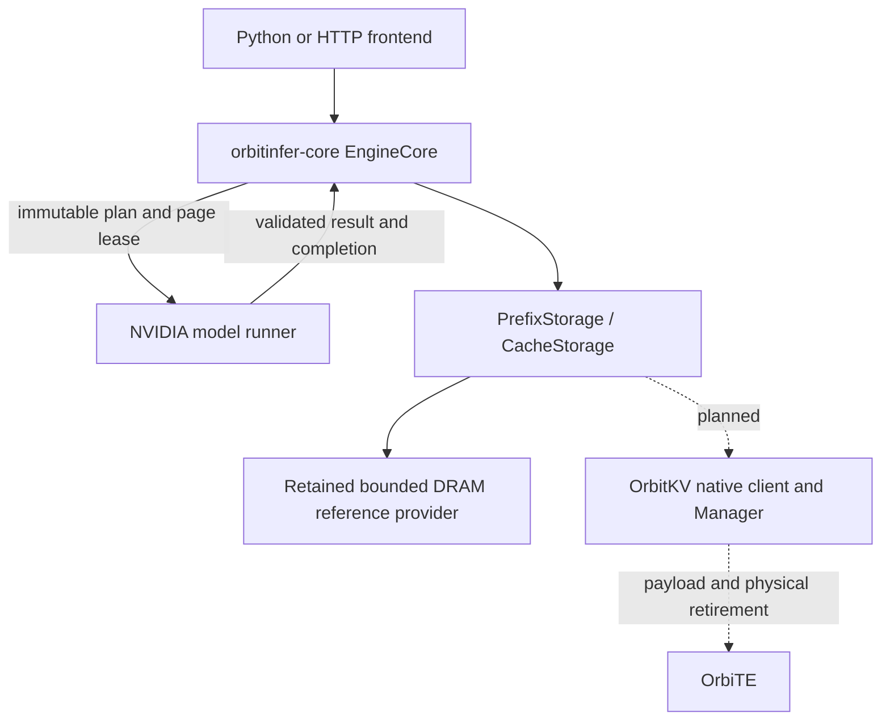

# Architecture

OrbitInfer is an NVIDIA inference runtime derived from a pinned Resin source
snapshot. The architecture below is the initial project contract. It does not
claim production readiness or verified GPU behavior.

## Owners and extension points

`EngineCore` owns requests, priority, batching, token progress, logical cache
allocation and reader/writer leases. A runner binds its actual arena once,
receives immutable token/page metadata, and executes model-specific math. Its
completion must retain output and device feedback independently of graph buffers
that the next step can reuse. The binding drives the same core; it is not a
second coordinator.

`CacheLayout` declares full-history, window and checkpoint retention. A model
must export every byte required to resume a declared checkpoint. The external
provider owns immutable copies outside the device cache and its own budgets.
Model/weight/layout identities must isolate incompatible objects; token prefixes
alone do not establish compatibility.

Python `CacheStorage` uses `lookup`, `store`, and `load`. A terminal successful
or failed transfer means all borrowed-buffer accesses have ended. Unknown
completion retains the borrowed pages. The native `PrefixStorage` contract is
the Rust integration point; no OrbitKV implementation is claimed yet.

| Contract | Source owner | Extension rule |
| --- | --- | --- |
| Scheduling and prepare/commit | `crates/orbitinfer-core/src/engine.rs` | Keep one core and one transaction per execution domain. |
| Logical pages and external storage | `crates/orbitinfer-core/src/resources/paged_kv.rs` | Implement `PrefixStorage`; retain page and backing loans for pending operations. |
| Runner and completion | `orbitinfer/protocols.py` | Implement `Runner` or `EnqueuingRunner`; accepted asynchronous work needs an owned completion. |
| Python cache provider | `orbitinfer/cache_storage.py` | Implement lookup/load/store with terminal results proving retirement. |
| CUDA arena, stream and graph helpers | `orbitinfer/backend/cuda/` | Reuse the runner's actual memory and completion owners. |
| First model | `models/cuda/orbitinfer_models_cuda/deepseek_v41/` | Bind the declared layout and execute the core's plan; do not schedule a second batch. |

## Initial implementation

The source import keeps the Rust engine, HTTP and recipe crates, Python binding,
shared CUDA helpers and DeepSeek runner. HTTP and recipe are existing binding
dependencies; preserving them avoids a behavior-changing extraction during the
initial import. Their generic formats are not declarations that all model
runners are supported. Only the DeepSeek CUDA model implementation is imported.

The Python package is `orbitinfer`, its extension is `orbitinfer._native`, and
the model package is `orbitinfer_models_cuda`. There are no `resin` aliases.
The source is local, not a runtime dependency on an installed Resin package.

Keep one runner and one resource layout per engine. Start with source-level
interfaces and construction-time selection. Dynamic binary plugins, hot unload,
multi-model batching and a second resource manager are not part of this step.

## Cache and transfer boundary

OrbitInfer owns inference scheduling and HBM page leases. OrbitKV owns semantic
cache identity, DRAM/SSD/peer replicas and their policy. OrbiTE owns actual local,
file and peer transfers. A future adapter must retain allocator-issued page
ownership and actual GPU backing across Restore and Publish. It must not invent
a local generation counter as a substitute for an allocator receipt.

Ready, logically complete and physically retired are separate states. Event
publication permits the declared stream dependency; it does not release backing.
Cancel, timeout, manager death and Python GC do not prove device quiescence.
Persistent model state changed before a failure cannot safely be replayed even
if a later synchronization establishes device quiescence.

The imported core contains quarantine and lease controls. The final-reference
path after failed CUDA synchronization remains a specific integration audit:
verify that arena backing, Python owners and native registrations survive, not
just a logical page record. Do not enable an installed profile until this passes.

## Model scope

DeepSeek-V4.1-Flash is the initial NVIDIA implementation. Use full execution
(`swa_replay_mode="off"`, no speculative drafts, overlap disabled) for the first
numerical baseline. Approximate SWA replay, graphs, overlap and speculative
decoding are enabled only with separate comparisons. The inherited constructor
defaults remain unchanged in this source import; the installed baseline must
pass those conservative options explicitly.

Qwen, Kimi and GLM require separate runner, state-export and numerical acceptance.
Ascend, ROCm and MLX/Metal execution are excluded. CPU is used for control-plane
tests and fixtures, not as a production model backend. Collectives stay with the
runner and its NVIDIA libraries; they do not move into OrbiTE.

The detailed source findings and phased work are in [the design](architecture-plan.md).
