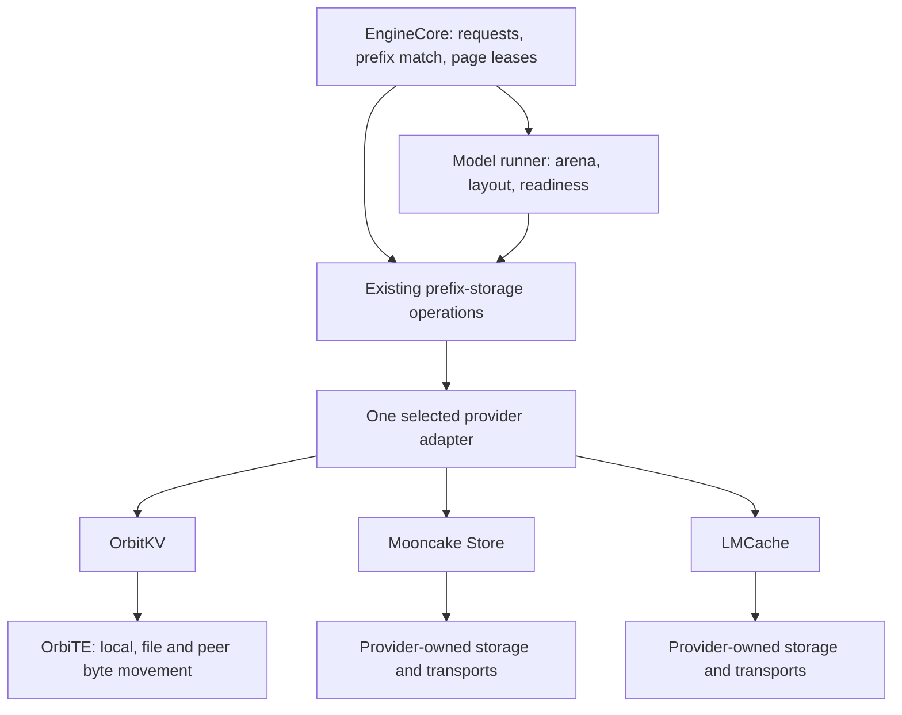

# Hierarchical external KV cache

Design and implementation sequence. The current interface and independent
retirement receipts are described in [prefix cache storage](cache-storage.md).
Identity binding, byte budgets and the provider adapters remain proposed work.
No OrbitKV, Mooncake Store or LMCache adapter is implemented yet.

## Scope

Keep one inference scheduler and one device-page allocator. A model runner
exports the state needed to resume a prefix; a selected storage provider retains
that state outside the device pool. Start with immutable prefix checkpoints,
including full-history KV, sliding-window KV and recurrent state. This is not
transparent paging of a live tensor or offloading model weights.

The first provider integration is OrbitKV. Mooncake Store and LMCache are
alternative providers behind the same boundary. Select one provider when binding
an Engine. Do not stack three cache managers or add a provider-routing service.
Provider packages and their dependencies remain optional.

E/P/D means encoder, prefill and decode in this document; EP means MoE expert
parallelism. Independent E/P/D services, pipeline parallelism and cross-mesh
resharding are separate work. External prefix reuse does not establish a live
request handoff between prefill and decode workers. See [parallelism](distributed.md#deployment-status).

## Tiers and placement

| Storage | Owner | Role |
| --- | --- | --- |
| Device memory | Runner backing; Engine page leases | Active requests and reusable resident prefixes share the existing pool |
| Host DRAM | Selected provider | Bounded cache of immutable checkpoints; pinned staging is charged separately |
| Local SSD | Selected provider | Capacity tier, reached through its file and staging owners |
| Peer DRAM or SSD | Selected provider's peer/source owners | Another placement of cached state, acquired with a valid source lease |

Peer locality is independent of the storage medium. A restore need not traverse
every tier: a provider may restore from a peer directly or read SSD directly
when its transport supports that route. OrbitInfer asks for a checkpoint and a
destination; it does not prescribe an HBM → DRAM → SSD → peer copy chain.
On Apple Silicon, device and host views may share physical memory. They are not
two independent capacity budgets, and MLX needs its own exporter before it can
use this interface.

The three outgoing adapter edges are alternatives. OrbiTE is a transfer engine,
not a cache provider or a global directory.

## Existing pieces and required changes

| Existing owner | Keep | Work required before integration |
| --- | --- | --- |
| `EngineCore` and `PagedKvResources` | Prefix matching, page allocation, storage jobs and commit | Prove final-reference retention of actual backing; add byte accounting for external operations |
| `PrefixStorage` / `PrefixStorageOperation` | Native lookup/transfer/poll boundary; Python outcome/retirement receipts | Complete the remaining native-runner backing audit without a second progress loop |
| `_PrefixStorage` / `CacheStorage` | `lookup`, `load`, `store`; immutable objects | Bind representation identity and validate provider retirement semantics |
| `cache_storage_buffers` | Runner's named region views, no export-time copy | Retain arena and registration owners, generation and producer readiness explicitly |
| `MemoryCacheStorage` | Bounded DRAM reference provider and existing controls | Audit final-owner and failed-fence paths before declaring the new contract complete |

Today regions are contiguous `torch.uint8` views; their Python objects are held
by storage operations. The current keys hash token-prefix and namespace data,
but do not include weight revision or a cache-layout fingerprint. Sharing
requires manually separated provider namespaces. The new binding must validate
both semantic identity and representation before allowing shared reuse.

The native storage trait and Python injection path already exist. P0 is an audit
and extension of those owners, not a new coordinator. A retained page number or
Python wrapper alone is insufficient if its arena backing can disappear.

## Identity and complete checkpoints

Bind an immutable identity once per Engine/provider pair, with these inputs:

- Model weight revision, architecture parameters that affect cached state,
  adapters such as LoRA, and position/attention configuration.
- Cache-format revision, dtype and quantization, named-region layout, block
  alignment, and logical shard coordinates. A digest must cover these fields.
- Token-prefix and media identity, plus a consumer-supplied reuse namespace.
  `cache_salt` remains a partition key, not authentication.

The runner supplies representation metadata; the Engine supplies request
identity and the legal resume boundary. OrbitKV owns its canonical storage
identity and placement. The adapter maps these inputs to that identity rather
than maintaining a second catalog. Other providers receive a validated
namespace and immutable object keys.

Full-history blocks may be shared by several endpoints. Sliding-window and
recurrent snapshots must belong to the same committed token endpoint. A bounded
manifest identifies every required group, region length, representation and
integrity check. Publish it only after its payload is available. A missing,
short, corrupt or mismatched component makes the checkpoint unusable; never
assemble state from different endpoints or silently convert layouts.

Replica rank numbers are not model identity. Identical DP replicas may reuse
bytes; shards must match logical coordinates and representation. EP placement
alone does not describe KV sharding. Initially require an identical layout and
mesh. Distributed restore commits only after all required ranks agree on a
usable boundary; one rank's hit cannot advance the whole replica. Cross-mesh
conversion and layer-streamed restore are deferred.

## Operations and ownership receipts

Retain the three operation kinds. The following is the proposed internal
contract, not a second public plugin API:

| Operation | Input | Result and retained owners |
| --- | --- | --- |
| Lookup | Identity and candidate prefix objects | Advisory availability; bounded metadata, no borrowed device pages |
| Load / Restore | Validated checkpoint and private destination views | Whole-checkpoint outcome; destination arena, page lease, registrations and transfer owners held until retirement |
| Store / Publish | Committed checkpoint and immutable source views | Publication outcome; source read lease and readiness held until the last source reader retires |

Each accepted transfer has two independent observations: its logical outcome,
and proof that it can no longer access borrowed memory. Submission rejection
may release immediately only when no access was accepted. Completion polling
uses the existing Engine storage jobs and provider progress owner. A blocking
SDK must run on a bounded provider worker, never on the scheduling thread.

Validate every exported range, allocation generation, memory type and access
permission before accepting I/O. Retain the actual exporter and registration;
a raw pointer is not an owner. Reject conflicting destination aliases before
any copy. An exporter must include all bytes a resumed kernel can read.

| Observation | Engine action |
| --- | --- |
| Pending, including cancel or deadline with drain pending | Retain buffers, registrations, leases and charges; do not publish a restore |
| Success and borrowed-buffer retirement proven | Commit a valid restore; release the transfer lease |
| Failure and borrowed-buffer retirement proven | Discard private restored pages and recompute, or abandon a backup |
| Unknown retirement / failed native cleanup | Quarantine actual owners, keep charges, stop admission to the affected owner; no retry or fabricated completion |

The Python interface now returns `CacheTransfer` with separate outcome and
retirement futures. A logical exception cannot release buffers. The binding
returns a terminal native transfer result only after a successful retirement
receipt; failed retirement is sticky, retains the actual exported views and
fences new storage work. This is tested through the real Engine, including final
reference drop. The wider native-runner and GPU execution audit remains in P0.

For load, acquire private destination write leases before accepting physical
work, and order copies after source readiness. Make the restored pages visible
to a runner only after all required bytes and groups are valid and writes have
retired. A short transfer cannot expose a partial KV checkpoint. Recompute may
reuse those pages only after a release receipt.

For store, wait on the runner's producer dependency before reading its bytes.
Prevent overwrite or page reuse while that read is outstanding. A provider may
release the device source after a proven copy into its own charged staging
allocation, then continue SSD or peer work. That release is not publication:
lookup must not advertise the object until the provider can serve it completely.
The staged allocation and operation budget remain owned until their own I/O
retires. SSD residency is a cache property, not a durability guarantee.

Cancellation, Engine close, provider close and final-reference drop fence new
work and drain accepted work. A bounded close may report failure while keeping
the ownership graph retained. Quarantined owners stay charged, and failed
native destroys are not retried. No uncertain WRITE or model step is replayed.
The implementation must prove this on the actual arena, not only logical pages.

## Budgets and scheduling

Keep the current resident-prefix-first policy initially, including its limit:
a partial device hit suppresses a search for a longer external hit. On a device
miss, restore into private pages while unrelated requests can run. Keep existing
checkpoint write policies; no unconditional backup on every decode step.

Add bounds to the existing owners, validated at bind:

| Budget | Charged resource | At exhaustion |
| --- | --- | --- |
| In-flight operations and metadata | Lookup/load/store batches, keys and manifests | Skip optional lookups/backups; no unbounded queue |
| Borrowed bytes and device pages | Actual storage-transfer leases | Do not admit another restore or backup |
| Staging and registrations | Pinned slabs, descriptors and native registrations | Reject before acceptance or wait within an already reserved budget |
| Provider residency | DRAM, SSD, objects and indexes | Evict only unborrowed entries; provider owns policy |
| Quarantine | The same retained owners and charges | Keep them charged and fence the affected owner; do not evict to hide retention |

Separate foreground restore capacity from background backup capacity so a
write-back burst cannot consume every operation slot or staging byte. The
adapter carries request priority and restore/backup intent to a provider that
supports them; unsupported QoS must be reported as a capability limit. This does
not promise decode-first scheduling from the current Engine.

Charge each allocation once in its owning pool; shared borrowers retain it.
Track operation count and borrowed bytes as separate limits. Configuration must
not let several adapters each assume the full host budget. Do not choose new
capacity or bandwidth defaults without measurement.

Initially use deterministic lookup and restore, without an adaptive controller.
After measurement, compare predicted restore completion with recompute time and
prefer a longer external hit only when useful. Such policy work must not change
the retirement rules or retry an accepted transfer into the same pages.

## Provider adapters

Each adapter binds capabilities once: supported memory/export types, layout,
maximum batch size, registration requirements and completion/cancel semantics.
An unavailable capability is rejected before binding or submission. Do not
silently switch providers after work has been accepted. Shared source tokens
must include the provider's authoritative incarnation and allocation generation;
presence checks or network addresses are not authority.

| Provider | Boundary to use | What stays outside OrbitInfer |
| --- | --- | --- |
| OrbitKV, first | Native client recovery requirements, Publish/Restore and their ownership receipts | Manager tier policy, identity/catalog, SSD codec, peer grants; OrbiTE owns byte movement |
| Mooncake Store | Registered-buffer get/put and batch APIs, wrapped by one bounded operation owner | Store membership, placement and transport selection |
| LMCache | A pinned standalone client/service interface after its buffer/retirement audit | Storage manager, DRAM/SSD/peer policy and service lifecycle |

Mooncake's API exposes per-object results and registered multi-buffer operations.
Validate every byte count and region mapping; an error code alone is not a
physical-retirement proof. A provider without a sufficient proof must use its
own retained staging or remain unsupported. Avoid registering and unregistering
buffers per block when the provider supports a retained registration lifetime.

LMCache documents a separate MP service with a typed request client. Audit one
fixed client/server version before selecting it; do not import a vLLM/SGLang
connector as OrbitInfer's scheduler or assume a service reply proves GPU drain.
Neither optional adapter introduces a mandatory C++ or Python service into the
Rust Engine. No external backend is a dependency of the core.

## Correspondence with serving engines

References checked on 2026-11-15; these are design inputs, not runtime dependencies.
Use the separation of responsibilities without importing another scheduler.

| Reference boundary | OrbitInfer counterpart | Initial limit |
| --- | --- | --- |
| vLLM `get_num_new_matched_tokens` / `update_state_after_alloc` | Native prefix lookup, then private page reservation | Retain current resident-prefix-first policy |
| vLLM `register_kv_caches` / `start_load_kv` / `save_kv_layer` | Runner exporter and provider load/store | Whole checkpoints initially; no layer-streamed resume |
| vLLM `request_finished` / `get_finished` / `wait_for_save` | Retain page loans until the independent retirement receipt | A request's logical end never releases an active copy |
| SGLang `HiCacheStorage` and registered host pools | One provider owns DRAM/SSD/peer storage; runner retains device backing | No second host-cache manager inside OrbitInfer |
| SGLang `PoolTransfer` and representation/shard configuration | Named checkpoint groups and planned identity binding | No implicit layout conversion or resharding |

vLLM explicitly lets a connector retain blocks after request completion and
report their completion later. SGLang supplies separate backend operations over
registered pools and named state components. OrbitInfer keeps its existing Rust
`PrefixStorage` owner and Python `CacheStorage` boundary. The independent
`CacheTransfer.retirement` receipt makes buffer-release authority explicit even
when an adapter reports a logical error first.

Pinned sources: [vLLM connector](https://github.com/vllm-project/vllm/blob/85217ffebbab2905386bac2e38566e09912da25a/vllm/distributed/kv_transfer/kv_connector/v1/base.py)
and [SGLang HiCache storage](https://github.com/sgl-project/sglang/blob/17e4738c4c94310d506328415831724f08ed9614/python/sglang/srt/mem_cache/hicache_storage.py).

## Acceptance and sequence

Use the same provider contract suite, with real CPU bytes first. Fault controls
must force interleavings and inspect backing and budget receipts.

| Control | Required result |
| --- | --- |
| Round-trip history/window/state at an aligned endpoint | Full byte/guard equality and identical resumed model state |
| Lookup hit followed by eviction; short load; one missing group | No partial checkpoint commit; recompute only after drain |
| Wrong weights, adapter, dtype, layout, namespace or shard | Reject before touching destination bytes |
| Source not ready; source overwrite while store is pending | Wait for producer; retain the read lease |
| Cancel, timeout, final Engine/runner/provider drop, failed fence | Actual backing and registrations survive until receipt; uncertainty remains charged |
| Duplicate backup and payload failure before manifest publication | No partial hit, immutable result and bounded pending work |
| Byte/slot exhaustion; background saturation; pinned entry eviction | Enforced bounds, foreground reserve and no borrower reuse |
| Peer restart or stale source generation; one rank misses a shard | Reject stale authority; no mixed-generation or partial-replica commit |

1. **P0: ownership and identity.** Audit the current Rust/Python path, retain
   actual arena backing across final drops, and add identity and byte bounds.
   The Python storage receipt/view-retention controls are implemented. Native
   execution backing, identity binding and byte accounting remain open.
2. **P3a: OrbitKV local DRAM.** Add the thin adapter and a CPU contract test.
   Write the SM100 runner export/producer/readiness gate; run it only on an
   explicitly authorized installed host. Do not modify OrbitKV from this work.
3. **P3b: OrbitKV SSD and peers.** Separate byte-checked profiles through the
   existing OrbitKV/OrbiTE owners. No new transfer code in OrbitInfer.
4. **P3c/P3d: Mooncake Store, then LMCache.** Pin each provider, map every
   completion path and run the same controls. Refuse integrations whose lifetime
   contract cannot be established. Do not claim provider interoperability.
5. **Policy measurement.** Compare resident hits, DRAM/SSD/peer restore and
   recompute: TTFT, decode ITL, accepted tokens/s, hit coverage, retained bytes,
   queue delay and transfer completion. Include concurrent decode interference.

Full-model validation remains a separate gate in the [completion plan](completion-plan.md).
CPU tests and Apple tensor tests do not qualify DeepSeek on SM100. E/P/D or PP
deployment comes after this boundary is proven and needs a separate design for
request authority, live-state handoff, routing and abort safety.

## Source map

Reviewed 2026-11-15. OrbitInfer source baseline: `200cac4`; external integration
references are inputs to this proposal, not support or qualification claims.

- [Rust storage owner](../crates/orbitinfer-core/src/resources/paged_kv.rs),
  [Python bridge](../orbitinfer/_cache_storage.py), [provider](../orbitinfer/cache_storage.py)
  and [existing storage controls](../tests/test_cache_storage.py).
- [Runner/export contract](../orbitinfer/protocols.py), [parallel dimensions](../crates/orbitinfer-core/src/parallelism.rs)
  and [capability checks](../orbitinfer/backend/topology.py).
- [OrbitKV architecture](https://github.com/OrbitInfra/OrbitKV/blob/01d9e36c/docs/architecture.md),
  inspected read-only; its own completion plan controls implementation status.
- [Mooncake Store registered-buffer API](https://kvcache-ai.github.io/Mooncake/api-reference/python/mooncake-store.html)
  and [LMCache MP service](https://docs.lmcache.ai/mp/index.html), checked on the
  review date. Their versions must be pinned in each adapter implementation PR.
